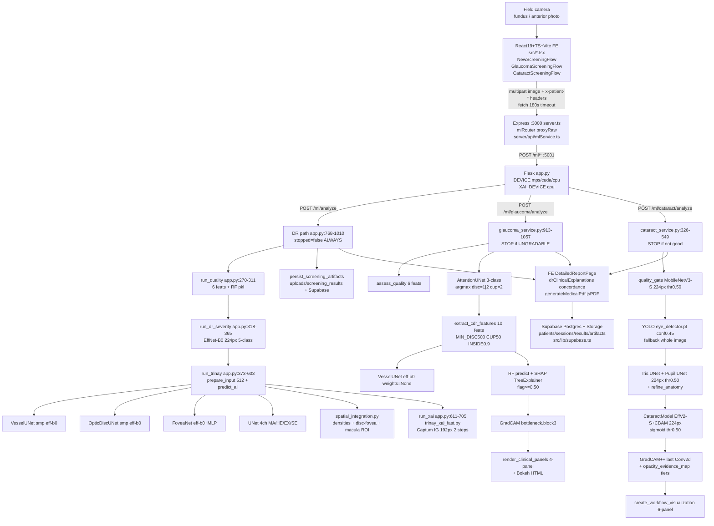

# TRINAY (RETINA-X) — Evidence-Based Technical Audit for Research Paper

> **Audit method:** read-only static inspection. No files modified, no training launched, no checkpoints loaded for retraining, no secrets exposed. Every technical fact cites `relative/path:lines`. Status labels: **Verified-code** | **Verified-artifact** | **README-only** | **Inferred** | **Missing** | **Contradicted**.
> Workspace root = `/Users/avirajmurkute/Desktop/retina-x (3)/` (referred as `ROOT/`).
> Generated: 2026-10-13. Source: repository-wide audit for research-paper preparation.

---

## Deliverable A — Executive Technical Summary

**What TRINAY actually is (verified):** a modular inference + visualization + report system, not a trained-from-scratch research codebase.

| Layer | Verified implementation |
|---|---|
| Frontend | React 19.0.1 + TypeScript 5.8.2 + Vite 6.2.3 + Tailwind v4.1.14 (`package.json:32-35,42-45`). ~40 components in `src/components/`. Entry `src/main.tsx`, `src/App.tsx`. i18n EN/HI/MR/TA/TE (+BN claimed, only 5 locale files found: `src/locales/en,hi,mr,ta,te.json`). |
| Gateway | Express 4.21.2 in `server.ts:75-123`. Spawns `app.py` on port 5001 (`server.ts:31-60`), proxies `/api/ml/*` via `server/api/mlService.ts`, serves Vite dev or `dist/` prod. |
| ML service | Flask + CORS in `app.py:122-126`. Device `mps>cuda>cpu` (`app.py:146-151`), XAI forced `cpu` (`app.py:153`). Endpoints: `GET /ml/health`, `POST /ml/analyze`, `/ml/quality`, `/ml/cataract/analyze`, `/ml/cataract/quality`, `/ml/glaucoma/analyze`, `/ml/glaucoma/quality`, artifact serve + PDF upload + RAG/translate/auth passthrough (`app.py:714-2077`). |
| DR pipeline (6 models) | Quality RF → EfficientNet-B0 severity (224px) → Vessel U-Net + Disc U-Net + FoveaNet + 4-ch Lesion U-Net (all 512px canonical) → spatial metrics → Captum IG XAI → base64 overlays → local `uploads/screening_results/<id>/` + optional Supabase persist (`app.py:768-1010`). |
| Glaucoma pipeline | Quality RF → Attention U-Net 3-class disc/cup → 10 CDR features → Vessel U-Net → RF classifier → SHAP + standard Grad-CAM + 4-panel + Bokeh HTML (`backend/glaucoma_service.py:913-1057`). |
| Cataract pipeline | MobileNetV3-Small quality → YOLO eye box → Iris U-Net + Pupil U-Net on eye ROI → EfficientNet-V2-S+CBAM binary classifier → Grad-CAM++ → opacity-evidence map → 6-panel workflow (`backend/cataract_service.py:326-549`, `trinay/trinay_pipeline_final.py:243-510`). |
| Decision support | Frontend-only concordance + referral text in `src/utils/drClinicalExplanations.ts:146-398`. PDFs via jsPDF in `src/utils/generateMedicalPdf.ts:149,852,1233` (dynamic values from passed `ReportRecord`, not hardcoded). |
| Chatbot/RAG | `backend/trinay_adapter.py:1-493` — ChromaDB + SentenceTransformers + Ollama + Faster-Whisper + Piper/`say`. Optional; health reports all-false if dirs/models absent. |

**Verified capabilities:** real end-to-end inference on uploaded images with real masks/overlays/XAI maps; quality + severity + anatomy + lesion + CDR + cataract outputs; artifact persistence; dynamic reports. **Single verified live example:** `outputs/test_response.json` (IDRiD_01.jpg → Moderate 97.4%).

**Not verified / missing:** zero training scripts, zero dataset loaders/splits, zero training logs, zero saved evaluation metrics/confusion matrices, zero cross-dataset or clinical validation. All dataset counts, hyperparameter tables, and performance tables in `README_TRINAY_PROJECT_DETAILS.md` / `TRINAY_MASTER_DOCUMENTATION.md` are **README-only** with no code/log support. DR quality gate does **not** stop the pipeline (contradicts README).

---

## Deliverable B — Architecture & Pipeline Diagram (verified-code)

**Per-workflow verified flow:**

*DR:* Input BGR → `decode_bytes_to_image` → `extract_quality_features` (advisory) → EffNet-B0 224px softmax → `prepare_input` crop+512 `/255` → 4 models `predict_all` sigmoid/thresh → `postprocess_masks` → `build_spatial_analysis` → Captum IG per-model → overlays (`create_*_overlay`) → base64 + `persist_screening_artifacts` → JSON. Downstream **never skipped** on Bad quality (`app.py:818`).

*Glaucoma:* Input → `assess_quality` → if `UNGRADABLE` return early (`glaucoma_service.py:918-933`) → `preprocess_for_segmentation` 512 + ImageNet norm → `segment_disc_cup` argmax → `extract_cdr_features` (INVALID_* fallbacks with dummy 0.35/0.15 features `glaucoma_service.py:940-957`) → vessels → RF → SHAP → Grad-CAM bottleneck → 4 panels + Bokeh.

*Cataract:* Input → `quality_gate` → if not good return `IMAGE_QUALITY_INSUFFICIENT` (`cataract_service.py:363-367`) → YOLO (+whole-image fallback) → 3% padded `eye_box` → `classify_cataract` on ROI only → iris/pupil `segment` on ROI → Grad-CAM++ on ROI mapped to full image → tiered opacity map → workflow composite.

**Intended-vs-implemented gaps:** README claims quality STOP for DR, 512px severity, ISNT rule, 3-class cataract grading, Grad-CAM++ for DR, SHAP for DR — none match code (see I).

---

## Deliverable C — Model Inventory

| Model ID | Task | Status | Arch (verified) | Framework | Source | Checkpoint (size, date) | Input → Output | Postprocess / thresholds |
|---|---|---|---|---|---|---|---|---|
| Q-DR | Fundus gradability 3-class | Implemented, training unverified | `RandomForest` (n_trees unverified; README claims 100 = README-only) | sklearn/joblib | train: **Missing**; infer `app.py:221-311` | `model/best_quality_model.pkl` 2.1M 14-Sep | BGR any-size → Good/Borderline/Ungradable + 6 feats | `label_map` lower→TitleCase; no score thresholds in code (RF direct) |
| SEV-DR | DR 5-class ICDR | Implemented, training unverified | `torchvision efficientnet_b0(weights=None)` + `Linear(1280→5)` (`app.py:326-328`) | PyTorch | train: **Missing**; infer `app.py:318-365` | `model/dr_severity_efficientnet_b0.pth` 16M | 224×224 RGB ImageNet-norm → softmax 5 {No DR,Mild,Moderate,Severe,PDR} | argmax; `confidence*100`; hardcoded `DR_RECOMMENDATIONS` (`app.py:172-178`) |
| VES-DR | Vessel binary seg | Implemented, training unverified | `smp.Unet(efficientnet-b0, imagenet, 3→1)` (`backend/unet_efficientnet.py:11-17`) | PyTorch+smp | train **Missing**; infer `backend/trinay_anatomy_lesion_pipeline.py:561-590` | `model/best_vessel_unet.pth` 69M | 512×512 RGB /255 no norm → sigmoid → mask | thresh 0.50 (`:95`); vessel overlay morph-close 3×3 (`:741-751`) |
| DISC-DR | Optic disc binary seg | Implemented, training unverified | Same smp UNet eff-b0 (`backend/optic_disc_unet.py:11-17`) — **not** Standard UNet as README Table claims | PyTorch+smp | train **Missing** | `model/best_optic_disc_unet.pth` 69M | 512 → sigmoid mask | thresh 0.50 (`:96`); amber fill+contour (`:758-777`) |
| FOV | Fovea regression | Implemented, training unverified | `efficientnet_b0(DEFAULT)` + `Dropout0.3-Linear128-ReLU-Dropout0.2-Linear2-Sigmoid` (`backend/fovea_net.py:9-36`) | PyTorch | train **Missing** | `model/best_fovea_net.pth` 16M | 512 /255 → [0,1]² ×512 clip | `validate_disc_fovea_geometry` plausibility only; `refine_fovea_faz` computed but **never applied** (`refinement_applied=False` always `:610-613,652-654`) |
| LES-DDR | Lesion 4-ch seg MA/HE/EX/SE | Implemented, training unverified | `UNet(3→4)` DoubleConv 64/128/256/512 bottleneck1024 (`backend/model.py:48-250`) | PyTorch | train **Missing**; infer `:623-638` | `model/standard_unet_ddr_finetuned.pth` 355M | 512 /255 → sigmoid 4×512×512 | thresh MA0.30 HE0.10 EX0.25 SE0.10 (`trinay_anatomy...:88-93`); `MIN_AREA {0:2,1:4,2:12,3:6}` + smooth/fill per-class (`backend/postprocess.py:20-25,158-237`); regions via contours |
| SEG-GLC | Disc/cup 3-class seg | Implemented, training unverified | `AttentionUNet(3→3)` 32/64/128/256 bottleneck512 + AttentionGate (`backend/glaucoma_service.py:145-205`) | PyTorch | train **Missing** | `glaucoma_model/best_attention_disc_cup_unet.pth` 30M 28-Sep | 512 ImageNet-norm → argmax {0 bg,1 disc,2 cup} | full_disc=1\|2, cup=2; `clean_mask` largest+close5×5; MIN_DISC500 CUP50 INSIDE0.90 (`:68-70`) |
| RF-GLC | Glaucoma struct clf | Implemented, training unverified | `RandomForest`/Pipeline (150 trees README-only) 10 feats | sklearn | train **Missing**; infer `:590-619` | `glaucoma_model/best_glaucoma_model.pkl` 3.4M | 10-vector → proba; flag≥0.50 (`:71`) | Fallback dummy feats if INVALID (`:946-957`); hardcoded recommendation strings |
| VES-GLC | Vessel (glaucoma path) | Implemented | Same smp UNet but `encoder_weights=None` (`backend/glaucoma_service.py:212-224`) — diverges from VES-DR | PyTorch+smp | train **Missing** | `glaucoma_model/best_vessel_unet.pth` 69M (duplicate size, separate file) | 512 ImageNet-norm (unlike DR path) → sigmoid | thresh 0.50 |
| Q-GLC | Duplicated quality | Implemented (duplicate file) | Same 6-feat RF, separate file | sklearn | infer `backend/glaucoma_service.py:372-437` | `glaucoma_model/best_quality_model.pkl` 2.1M | same → GOOD/UNGRADABLE (Borderline collapsed; +heuristic fov<0.25/sharp<10/bright<15 → UNGRADABLE `:428-430`) | — |
| Q-CAT | Anterior quality binary | Implemented, training unverified | `mobilenet_v3_small` + Identity + linear (`trinay/trinay_pipeline_final.py:136-154`; alt `trinay/quality_model.py:9-29`) | PyTorch | train **Missing** | `model/cataract_models/quality_model.pth` 3.7M (+dup `catract_models/`) | 224 ImageNet-norm → sigmoid | thr 0.50 (`:93`); GOOD vs RETAKE_IMAGE |
| DET-EYE | Eye bbox | Implemented, training unverified | `ultralytics YOLO` (`eye_detector.pt`, README claims YOLOv8n/YOLO11n — code just `YOLO(path)`) | Ultralytics | train **Missing** | `model/cataract_models/eye_detector.pt` 5.2M | 640 conf0.45 iou0.45 max2 (`:327-335`) | 3% pad; whole-image fallback conf0.85 (`:371-378`, `:450-456`) |
| IRIS | Iris binary seg | Implemented, training unverified | `UNet(3→1)` same DoubleConv pattern (`trinay/trinay_pipeline_final.py:173-202`) | PyTorch | train **Missing** | `model/cataract_models/iris_model.pth` 355M (same bytes as LES-DDR — needs hash check, suspicious duplication) | 224 ImageNet-norm → sigmoid → resize to ROI | thr0.50 + `largest_component` + `refine_anatomy` (`:405-414`) |
| PUPIL | Pupil binary seg | Implemented, training unverified | Same UNet 3→1 | PyTorch | train **Missing** | `model/cataract_models/pupil_model.pth` 118M | same | same |
| CLS-CAT | Cataract binary clf | Implemented, training unverified | `efficientnet_v2_s(DEFAULT)` + CBAM(1280) + Pool + Drop0.4-Linear256-ReLU-Drop0.3-Linear1 (`trinay/model.py:86-140`) | PyTorch | train **Missing** | `model/cataract_models/cataract_model.pth` 80M | 224 eye-ROI ImageNet-norm → sigmoid | thr0.50 NORMAL/CATARACT (`:94,400-402`); NO Mild/Severe grades (README contradicted) |
| CHAT/RAG | QA + STT/TTS | Partial (optional deps) | SentenceTransf multilingual-e5-small + ChromaDB + Ollama + Faster-Whisper + Piper/`say` | mixed | `backend/trinay_adapter.py` | dirs `rag/TRINAY_INTEGRATION/...` **absent** → `check_trinay_status` false | text → answer+sources+audio | `synthesize_rag_answer` fallback if LLM down |

**Checkpoint-vs-arch checks:** DR severity loader uses `strict=False` (`app.py:332`) — masks arch mismatch; lesion loader requires `model_state_dict` (`trinay_xai_fast.py:501-508`) vs others accept raw dict — inconsistent but functional. No state-dict hashes or `model-card` metadata shipped. Existence ≠ training success.

---

## Deliverable D — Dataset Audit

| Dataset (README claim) | Claimed use | Verified local evidence | Sample counts / splits / annotations | Status |
|---|---|---|---|---|
| DDR 13,673 + IDRiD 516 + EyePACS 35k/53k + DRIVE/STARE/CHASE | DR severity + lesion + vessel + disc/fovea training | **None.** No loader, manifest, `data/` dir, or URL in code. Only docstring example `data/anatomy/IDRid/.../IDRiD_01.jpg` (`backend/trinay_anatomy_lesion_pipeline.py:24-25`, `trinay_xai_fast.py:37`) + `test_images/IDRiD_01.jpg` + `outputs/test_response.json` single inference | 1 demo image only; no train/val/test counts, no patient split, no mask files | **README-only / Missing** |
| REFUGE 1200 + RIM-ONE 600+ + Drishti-GS1 | Disc/cup training + CDR validation | **None.** `glaucoma_backend/calculate_cdr.py:632-654` references `outputs/inspection/segmentation_manifest.csv` but file absent; `final_glaucoma_pipeline.py:75-83` points to `ROOT/models/...` which does not exist (real dir is `glaucoma_model/`) | No images, no CDR ground truth | **README-only / Missing** |
| ODIR-5K 10k + Anterior 4,800 | Cataract + eye/iris/pupil training | **None.** No loader; only `trinay/preprocessing.py:8-43` augments (flip/rot10/ColorJitter/blur) with no dataset binding | No class counts | **README-only / Missing** |
| EyeQ 28,792 | Quality RF training | **None.** No labels, no synthetic-degradation script. `pipeline/quality_model.py` + `trinay/quality_model.py` are arch stubs only | Synthetic-vs-real breakdown impossible | **README-only / Missing** |
| Supabase clinical data | Patients/sessions/results/artifacts | Schemas **inferred from queries only** (`app.py:896-1004,1109-1181`; `server/api/screeningService.ts`): `patients, profiles, screening_sessions, screening_results, screening_artifacts, referrals...` — no `supabase/migrations/*.sql` in repo (`supabase/` only `functions/create-user,share-report` + `requirements.txt`) | Live counts require DB access (not done per rules) | **Inferred, schema dump missing** |

**Synthetic quality audit:** cannot establish source images, degradations, labels, per-class N, or leakage — no code. **Licensing/ethics:** no LICENSE, no dataset licence notes, no de-ID docs. **Do not cite published N as project N.**

---

## Deliverable E — Algorithms & Mathematical Methodology (code-verified only)

**E1. Quality (DR + glaucoma share 6 feats, 3 divergent implementations):**

Canonical (`app.py:221-267`, mirrored `backend/glaucoma_service.py:372-406`):
- S = Var(Laplacian(I_gray)) via `cv2.Laplacian(gray,CV_64F).var()`
- mu_B = mean(I_gray)
- U = mean(center)/(mu_B+1e-5); DR center = middle-half crop (`h//2±h//4`), glaucoma = `min(h,w)//4` square
- C_rms = std(I_gray)
- sigma_N = std(I_gray − GaussianBlur_5x5(I_gray))
- R_fov = |{I_gray>15}|/(h·w)

Divergent third impl (`glaucoma_backend/final_glaucoma_pipeline.py:323-350`): Tenengrad S=mean(Gx²+Gy²) on retina mask, U=1−sigma/mu — **do not mix with above for paper.**

Classifier: `joblib RF predict/predict_proba`; DR maps lowercased labels → Good/Borderline/Ungradable (`app.py:294-299`); glaucoma collapses to GOOD/UNGRADABLE + heuristic override (`glaucoma_service.py:428-430`). Threshold learning/selection: **Missing** — no ROC/threshold sweep code.

**E2. DR:**

- Severity: Resize224 → ToTensor → ImageNet norm → EffNet-B0 → softmax5. Loss: **Missing** (no training). README `512px + Dropout0.4` partially contradicted (code 224px, no dropout in head).
- Vessels/disc: sigmoid → ≥0.50.
- Fovea: (x,y)=(x_hat·512, y_hat·512) clipped; geometry `validate_disc_fovea_geometry` (`trinay_anatomy...:456-546`): plausible iff `fovea in retina (r≤0.47·min)` AND `1.4≤D/DD≤4.5` (or 60–290px) AND temporal side AND |y_f−y_d|≤max(60,1.8DD).
- Lesions: per-channel sigmoid → thresh above → `postprocess_masks` (MIN_AREA/smooth/fill) → `summarize_masks` (`pixels=count_nonzero`, `regions=contours`, `detected=pixels>0` `postprocess.py:323-360`). Spatial: D_DF=sqrt((x_f−x_d)²+(y_f−y_d)²) (`spatial_integration.py:157-160`); vessel density D=N_ves/(512²), macular D_m=N_ves∩ROI/|ROI| (`:227-311`); macula ROI = circle r=0.12·min(H,W) (`:521-526`) — app overlay uses 0.11·512=56px (`app.py:507,536`) — minor inconsistency flagged. Lesion-macula overlap available (`analyze_lesion_locations`) but **not called** in live `run_trinay` — DME risk is display-only.
- Concordance: frontend rule table (`drClinicalExplanations.ts:171-294`): NoDR+0→concordant_negative; DR+>0→concordant_positive; DR+0→discrepant_classifier_positive; NoDR+>0→discrepant_classifier_negative; Ungradable→insufficient_quality; no lesions→indeterminate. No backend enforcement.

**E3. Glaucoma:**

- Seg argmax → `full_disc=(pred==1)|(pred==2)`, `cup=(pred==2)` → `clean_mask` → areas → inside_ratio =|cup∩disc|/|cup| must be ≥0.90 else INVALID (`glaucoma_service.py:501-517`); constrain `cup&=disc`.
- VCDR=H_cup/H_disc, HCDR=W_cup/W_disc, ACDR=A_cup/A_disc via `boundingRect` (`:549-551`). ISNT rule: **not implemented** (zero hits for `ISNT` in `.py`; only UI text `GlaucomaScreeningFlow.tsx:846,933`). CDR≥0.65 shown as UI label (`GlaucomaReportPage.tsx:240,250`) but classifier flag is RF proba≥0.50, not CDR threshold.
- RF 10 feats `FEATURE_COLUMNS` (`:73-84`); SHAP `TreeExplainer` → fallback `feature_importances_` → fallback 0.1 (`:621-668`).
- Grad-CAM (standard, **not** ++): bottleneck `block[3]` activations, w_k=mean(grad), CAM=ReLU(sum w_k·A_k) normalized (`:231-275`).

**E4. Cataract:**

- YOLO → 3% padded ROI → MobileNet quality already gated → UNet iris/pupil on ROI (ImageNet-norm 224, sigmoid≥0.50, largest-component, `refine_anatomy`) → EffV2-S+CBAM on ROI (sigmoid≥0.50).
- Grad-CAM++ (`trinay/visualize_trinay_workflow.py:258-374`): second/third gradients alpha, target = predicted class logit; last-Conv2d auto-target. Opacity map fuses `cam_norm` + Gaussian-blurred luminance: if p≥0.50, score=0.65·cam+0.35·scatter blurred+rescaled×p; else 0.30·cam·p (`cataract_service.py:244-252`). Tiers: VERY_HIGH ≥0.80&p≥0.60, HIGH ≥0.60&p≥0.45, MOD ≥0.35&p≥0.38, LOW 0.15–0.35 (`:263-277`); `opacity_px=HIGH+MOD`, intensity HIGH if ≥8% or high≥5%, MOD if ≥2% (`:163-193`). Rendering alpha 0.45–0.70 does not alter counts.
- ROI→orig mapping: `crop_box` + full-image `full_cam` zero-pad placement (`:436-439`).

**E5. XAI (DR):** Captum `IntegratedGradients(forward_fn)` baseline zeros, `n_steps=2`, `riemann_trapezoid`, CPU, input 192² (`trinay_xai_fast.py:104-105,102,708-718`). Target = top-8% probs (≥92nd pct) capped 1200px (`:108-111,600-667`); fovea = max(x-IG,y-IG) (`:893-923`). Norm pct75–99 + blur0.7 (`:117-118,576-580`); overlay JET threshold0.15 power1.35 alpha0.65 resized to 512 (`:975-1064`). Combined = max(anatomy,lesion) normalized. Lesions: detected-only.

Equations from README (Focal+Dice alpha=0.25,gamma=2, Fast-IG M=2, Grad-CAM++ alpha formula, SHAP Shapley sum) match **generic literature**, but loss/optimizer/scheduler have **no code support** — do not cite as implemented.

---

## Deliverable F — Training & Reproducibility

| Item | Evidence |
|---|---|
| Training scripts/configs/seeds | **Missing.** `grep train` hits only inference/augmentation stubs; no `train*.py`, YAML, or seed (except `RANDOM_STATE=42` for glaucoma inference RNG `final_glaucoma_pipeline.py:96,123-124`). |
| Init / pretrained | Partial-verified: FoveaNet `EfficientNet_B0_Weights.DEFAULT` (`fovea_net.py:15-19`); Vessel/Disc smp `imagenet` (DR) / `None` (glaucoma vessel); Cataract EffV2-S `DEFAULT` + MobileNet `DEFAULT` (`trinay/model.py:92`, `quality_model.py:15`); Severity `weights=None` (from scratch or fully fine-tuned — unknown). Fine-tune freeze strategy: **Missing**. |
| Loss / optimizer / LR / scheduler / batch / epochs / early-stop / selection | **All Missing.** No `CrossEntropy/Dice/Focal`, `Adam/AdamW`, LR, batch, epoch, or checkpoint-selection code. README §7.1 table is README-only. |
| Augmentation | Only cataract `train_transform` (flip p0.5, rot10, ColorJitter, blur p0.1) (`trinay/preprocessing.py:8-31`) — no proof it was used. DR/glaucoma augments: Missing. |
| Data splits | Missing (no manifests). |
| Hardware / versions / duration / curves | Hardware dispatch verified (above); `torch/torchvision/smp/timm` declared in `requirements.txt:1-2,18-19` (versions unpinned, installed env not inspected per rules); training duration/curves: Missing. |
| Checkpoints | Best+final distinction impossible — single file per model, no timestamps mapping to runs. Iris 355M == lesion 355M size collision needs dedup check before claiming separate training. |

**For paper:** report hyperparameters as *inference* config only; list all training hyperparams as *not disclosed by repository*.

---

## Deliverable G — Verified Results Matrix

| Model/task | Dataset / split / N | Metric | Value | Evidence file | Status |
|---|---|---|---|---|---|
| DR severity 5-class | Unknown (no test set) | Acc / F1 / AUC / QWK / Sens/Spec | — | none | **Not found.** README §7.2 (Sens94.2 Spec92.8 AUC0.962 QWK0.841 Acc86.4 F10.812) = README-only, zero logs/CSVs |
| Vessel seg | Unknown | Dice/IoU/Prec/Sens | — | none | **Not found.** README Dice0.835 etc = README-only |
| Disc seg | Unknown | Dice/IoU/boundary | — | none | **Not found.** README Dice0.952 = README-only |
| Fovea | Unknown | mean err / %<15px | — | none | **Not found.** README 8.2px/96.4% = README-only |
| Lesion MA/HE/EX/SE | Unknown | Dice per class | — | none | **Not found.** README 0.612/0.748/0.782/0.710 = README-only |
| Glaucoma clf / CDR err | Unknown | Sens/Spec/AUC/MAE/R | — | none | **Not found.** README Sens93.1 Spec91.4 AUC0.951 MAE0.042 R0.93 = README-only; SHAP outputs exist at runtime but no saved values |
| Cataract | Unknown (ROI vs full?) | Acc/Prec/Rec/AUC | — | none | **Not found.** README 95.6/94.0/94.8 = README-only |
| Quality RF | Unknown (real vs synthetic?) | Acc per-class P/R/F1 / CM | — | none | **Not found.** |
| Integrated pipeline | `test_images/IDRiD_01.jpg` N=1 demo | Latency / reject rate / failure / disagreement / memory | Single-case outputs only (Quality Good0.635, Moderate97.4%, vessels13232px/5.05%, disc3837px, 49 lesion regions) | `outputs/test_response.json:1` + `outputs/trinay_anatomy_lesion/IDRiD_01/*`, `trinay_xai_fast/IDRiD_01/*`, `uploads/screening_results/*` (187 session dirs) | **Verified-artifact (N=1, not evaluation).** No aggregate stats. |
| Isolation test | 2 cataract images | Distinctness + map-number consistency | Pass criteria coded, no saved run log | `scratch/test_trinay_isolation.py`, `test_cataract_sessions.py`, `test_xai_colorfix.py` | **Code exists, results Missing** (not executed per rules) |

**Metric hygiene notes:** `summarize_masks` counts 0/255 nonzero — correct; vessel density uses full 512² denominator (not FOV-masked) — underestimates vs FOV definition; glaucoma fallback injects dummy CDR 0.35/0.15 on INVALID — would contaminate any aggregate if not excluded; no per-image vs per-class averaging defined anywhere.

---

## Deliverable H — Explainability & Integration Report

| Component | Verified implementation | Validation evidence |
|---|---|---|
| DR IG | Captum IG, 192px, 2 steps, percentile targets, JET overlay (above). Per-model maps + combined. Triggered in `app.py:834-840`; failure → `xai=null + xaiError` (graceful). | Visuals in `outputs/trinay_xai_fast/IDRiD_01/` (9 PNGs). No faithfulness (insertion/deletion) or latency study. |
| Glaucoma Grad-CAM | Standard Grad-CAM on seg bottleneck, mask-weighted score. | `vessel_overlay`-style panels + Bokeh HTML string in JSON. No IoU vs disc/cup or clinician rating. |
| Cataract Grad-CAM++ | Full ++ with 2nd/3rd grads, auto last-Conv2d. | `outputs/*cataract*.png`, `raw_audit/*roi/mask/prob` (18 files). No pointing-game/energy scores. |
| Glaucoma SHAP | TreeExplainer with 2 fallbacks; returns per-feat contribs + base_value. | Runtime dict `shapImportance`; no saved beeswarm/dependence plots. |
| Pipeline integration | DR never gates; cataract/glaucoma gate correctly. Classifier↔seg discrepancies surfaced only as frontend text, never auto-escalate backend status. Confidence = softmax/sigmoid raw (uncalibrated — correctly disclaimed in `drClinicalExplanations.ts:508-527`). Missing preds → `indeterminate` + limitations list (`:562-596`). | `NewScreeningFlow.tsx:219` maps non-Good→Unsuitable but still renders severity — confirm in UI test before claiming gate. |
| Report generation | `generateMedicalPdf.ts` builds jsPDF A4 from passed record + data-URL images (`loadImageDataUrl`); `DetailedReportPage.tsx:28`, `ScreeningReportModal.tsx:23` wire dynamic anatomy/lesion/XAI; guideline strings (ICO/NHS) are static text in `drClinicalExplanations.ts:330,353,369` — correctly phrased as decision-support, not validated protocol. | No placeholder-image audit found (all `b64ToPngUrl` from live results); formal attestation block claimed in README but verify in PDF code before citing (file 1783 lines — spot-check §150-300). |

---

## Deliverable I — README-vs-Code Discrepancy Report

| README claim | Code evidence | Eval evidence | Status | Action |
|---|---|---|---|---|
| Severity input 512, Dropout0.4 | `app.py:335-340` Resize224, no dropout | none | **Contradicted** | Fix spec to 224; disclose head arch |
| Disc model = Standard U-Net | `optic_disc_unet.py:11-17` smp eff-b0 UNet | none | **Contradicted** | Correct to smp UNet |
| DR quality STOP on Bad | `app.py:818` `stopped=False` always; severity+TRINAY+XAI run unconditionally | `test_response.json` | **Contradicted** | Either implement gate or reword to advisory; cataract/glaucoma do gate |
| Lesion postprocess <3/<6px + Gaussian smooth | `postprocess.py:20-25` 2/4/12/6 + close3×3 + fill holes | none | **Partially confirmed** | Publish exact table + code ref |
| Illumination = 10/90 pct ratio 16 patches; Noise = Haar wavelet; FOV vs total canvas | Center/mean ratio; Gaussian-residual noise; gray>15 | none | **Contradicted** | Replace formulas with verified ones |
| Fast-IG <800ms CPU, 50→2 steps | 2 steps + 192px verified; timing unlogged | none | **Unverified** | Benchmark + report mean±SD |
| Grad-CAM++ for DR severity | Only standard Grad-CAM (glaucoma) + ++ (cataract); DR uses IG only | none | **Not implemented** | Remove or implement |
| SHAP for glaucoma verified + ISNT rule | SHAP yes; ISNT zero code hits, only UI prose | none | **Partially confirmed** | Drop ISNT as computed metric or implement rim-quadrant logic |
| Cataract 3-class Normal/Mild/Severe + pupil/iris boundaries + lens density | Binary NORMAL/CATARACT (`trinay_pipeline_final.py:400-409`); iris/pupil yes; density = opacity% proxy | none | **Partially confirmed** | Correct to binary + evidence-intensity (already disclaimed `cataract_service.py:163-193`) |
| 6 languages EN/HI/MR/TA/TE/BN | 5 locale files (BN missing); i18next wired | none | **Partially confirmed** | Add BN or list 5 |
| Ports 3000 gateway + 5001 ML; Bokeh; SHAP; Supabase Realtime | 3000+5001 + Bokeh + SHAP verified; Realtime channels not found (only REST + Storage) | none | **Partially confirmed** | Remove Realtime or cite channel code |
| All §7.2 metrics + §7.1 training table + §4 dataset usage | No trainers, loaders, logs, CSVs | **Not found** | **Unverified** | Move to future-work or supply logs |
| Two-page PDF + SVG/canvas overlays + attestation | jsPDF dynamic PDFs verified; SVG/canvas wording vs PNG overlays; attestation needs spot-check | demo PDFs in uploads (uninspected) | **Partially confirmed** | Verify attestation block lines |
| `server.ts` proxies `/api/ml/*` + auth + static | Verified `server.ts:84-101` + `server/api/*` | none | **Confirmed** | — |
| Flask `POST /api/ml/quality` returns quality_grade/score/is_gradable | Returns `{quality, confidence{}, features{}}` (`app.py:307-311`) — field names differ | none | **Partially confirmed** | Align docs to actual keys |

---

## Deliverable J — Research-Paper Readiness Gap Analysis

**Critical (blocks main claims):**
1. No train/val/test splits + N per model → cannot support any performance claim. *Action:* freeze datasets, publish manifests (image IDs, patient IDs, splits) + datasheets.
2. No saved metrics/logs/confusion matrices → §7.2 unpublishable. *Action:* run locked test-set eval script, save CSVs + figures.
3. No training configs (loss/optim/LR/epochs/seeds) → irreproducible. *Action:* recover configs from experiment trackers or retrain with logged config.
4. DR gate contradiction → safety claim false. *Action:* decide gate semantics, fix code/docs, measure reject/accept rates.
5. Cataract/DR grading overclaims (Mild/Severe, ISNT, Grad-CAM++ DR) → must be removed or implemented.

**High priority:**
6. Threshold provenance (lesion 0.30/0.10/0.25/0.10, CDR flag 0.50, quality heuristics) — no ROC/threshold-selection study. *Action:* threshold-sensitivity curves on val.
7. Calibration — confidences uncalibrated (correctly noted) — need ECE/reliability diagrams if reporting probabilities.
8. Fovea/macula: estimated ROI, FAZ refinement dead code — validate error distribution + DME-overlap actually computed.
9. Duplicate dirs (`trinay/` vs `pipeline/` vs `catract_python/`) + `glaucoma_backend/` stale paths + iris/lesion size collision — dedup + hash checkpoints + pin canonical imports.
10. Quality feature divergence (3 impls) — lock one definition, version it.

**Recommended:**
11. XAI fidelity + overhead benchmarks; SHAP summary plots; Bokeh availability fallback note.
12. Supabase schema dump + Realtime proof or removal; PDF attestation verification; BN locale; license/ethics/de-ID statements; `requirements.txt` pin + `captum/shap/bokeh` add (currently `shap/bokeh` missing from requirements despite imports); device-specific (MPS/CUDA/CPU) parity test.

---

## Deliverable K — Proposed Experimental Plan (proposed ≠ completed)

| Exp | Hypothesis | Data | Metrics | Notes |
|---|---|---|---|---|
| E1 Locked test evaluation | Reported models generalize to held-out patients | Patient-disjoint test per disease (publish N, prevalence) | DR: acc, macro-F1, per-class F1, QWK, referable Sens/Spec + AUC + CM; Seg: Dice/IoU/Prec/Rec per class + boundary err; Fovea: mean/med err + %<15px; CDR: MAE + R + Bland-Altman; Glaucoma/Cataract: Sens/Spec/AUC/CM | Freeze checkpoints + thresholds; report 95% CIs (bootstrap), per-quality and per-severity slices |
| E2 Threshold sweep | Default thresholds are near-optimal | Val split | Youden/QWK/Dice vs thresh curves | Lock thresholds before test |
| E3 Ablations | Each stage adds value | Same test | Quality on/off; clf-only vs clf+seg concordance rate; FAZ refine on/off; iris/pupil refine on/off | Measure disagreement frequency + error propagation |
| E4 Cross-dataset | Domain robustness | Train A → test B (e.g., DDR→IDRiD, REFUGE→Drishti) | Same as E1 + calibration ECE | Duplicate/leakage check via pHash |
| E5 XAI fidelity/cost | XAI is faithful + affordable | Test subset | Insertion/deletion AUC, pointing-game, latency mean±SD + memory | Compare IG-2 vs IG-20/50, Grad-CAM vs ++ |
| E6 Reader study (pilot) | Decision-support helps triage | Enriched test + 2 graders | Agreement (κ), time, safety (discordant-case handling) | NOT clinical validation — label as pilot; ethics approval required |
| E7 Calibration | Scores → reliable probs | Test | ECE, reliability diagram, temperature scaling | Report uncalibrated until done |

Do not run E1–E7 until manifests + frozen checkpoints + ethics/data-use approvals are in place.

---

## Deliverable L — Research-Paper Evidence Map

| Paper section | Source files (+lines) |
|---|---|
| Materials: system/architecture | `server.ts:1-123`, `app.py:118-156,714-1320`, `server/api/mlService.ts`, `src/services/mlService.ts:103-200,358-590`, `vite.config.ts`, `package.json:14-46`, `requirements.txt:1-23` |
| Datasets | **No code** — only `test_images/IDRiD_01.jpg`, `outputs/test_response.json:1`, docstring paths `backend/trinay_anatomy_lesion_pipeline.py:24-25`; claims in `README_TRINAY_PROJECT_DETAILS.md:100-175` (cite as intended, not used) |
| Model Architecture | DR: `app.py:318-365`, `backend/unet_efficientnet.py:6-20`, `backend/optic_disc_unet.py:6-20`, `backend/fovea_net.py:9-36`, `backend/model.py:48-250,331-580`; Glaucoma: `backend/glaucoma_service.py:101-225`; Cataract: `trinay/model.py:6-140`, `trinay/trinay_pipeline_final.py:136-202,243-510`, `trinay/quality_model.py`, `trinay/preprocessing.py` |
| Training Protocol | **Missing** — no files; only inference transforms `trinay/trinay_pipeline_final.py:114-130`, `backend/trinay_anatomy_lesion_pipeline.py:290-314` |
| Preprocessing/features | `app.py:221-267`, `backend/glaucoma_service.py:372-406,442-453`, `backend/trinay_anatomy_lesion_pipeline.py:150-257,394-453`, `backend/spatial_integration.py:30-90,97-176,183-339,449-573`, `backend/postprocess.py:20-25,158-274`, `backend/anatomy_assessment.py` |
| Results | **No metric artifacts** — only N=1 demo `outputs/test_response.json`, visuals `outputs/trinay_anatomy_lesion/IDRiD_01/*`, `outputs/trinay_xai_fast/IDRiD_01/*`, `outputs/raw_audit/*`, `outputs/audit_results/*`; test stubs `scratch/test_*.py` |
| Explainability | `backend/trinay_xai_fast.py:98-126,524-732,831-968,983-1064`, `backend/glaucoma_service.py:231-275,621-689`, `trinay/visualize_trinay_workflow.py:258-374`, `backend/cataract_service.py:163-323` |
| Decision-support/reports | `src/utils/drClinicalExplanations.ts:25-596`, `src/utils/generateMedicalPdf.ts:149,852,1233`, `src/components/DetailedReportPage.tsx`, `src/components/NewScreeningFlow.tsx:183-252`, `src/components/GlaucomaScreeningFlow.tsx`, `src/components/CataractScreeningFlow.tsx` |
| Discussion/limitations | `backend/spatial_integration.py:18-23`, `backend/postprocess.py:9-15`, `backend/cataract_service.py:163-193`, `src/utils/drClinicalExplanations.ts:508-596`, `README.md:6-8` disclaimer |
| Reproducibility | `requirements.txt`, `package.json`, `.env.example` (do not publish `.env`), `TRINAY_MASTER_DOCUMENTATION.md` (secondary, not primary evidence) |

---

## Ten Most Important Missing Pieces (collect next)

1. **Patient-disjoint manifests + N per split** for every model (image IDs, patient IDs, labels/masks provenance).
2. **Frozen training configs** (loss+params, optim/LR/scheduler, batch/epochs, seeds, pretrained sources, freeze strategy).
3. **Locked test-set metric dumps** (CSVs + confusion matrices + per-class Dice/IoU/F1/AUC/QWK with CIs) — replaces README §7.2.
4. **Threshold-selection records** (ROC/sweep + chosen operating points for lesions, CDR flag, quality).
5. **Quality-gate decision** (DR advisory vs blocking) + measured accept/reject/failure rates + latency/memory stats.
6. **Checkpoint registry** (hashes, arch match, dedup iris vs lesion 355M, canonical `trinay/` vs `pipeline/` vs `catract_python/`).
7. **Fovea/macula validation** (error distribution, ROI radius justification, FAZ-refine on/off, DME-overlap wiring).
8. **XAI fidelity + cost study** (faithfulness scores, SHAP plots, IG-2 vs full-step comparison).
9. **Calibration + reader-pilot + ethics/data-use/licence/de-ID docs** (required before any clinical language).
10. **Schema dump + dependency pins** (`supabase` DDL, `shap/bokeh` in requirements, BN locale, PDF attestation check, MPS/CUDA/CPU parity).

*Bottom line for your paper:* cite only inference architecture, preprocessing formulas, thresholds, and N=1 demo as verified; present all datasets, training, and performance numbers as **future work pending locked evaluation** — otherwise the claims are unsupported.

---
*End of report. This file is the file-backed copy of the in-chat technical audit. No repository source files were modified to produce it. Secrets redacted. No patient images copied.*
